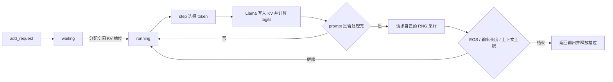

# 从请求到下一个 token

本项目参考 DeepInfer 的推理流程，用同步 Python 调度和 CPU float32 运算展示数据如何流动。模型采用普通 Llama，方便在笔记本上加载小权重。这里没有实现 DeepSeek-V4.1 的模型结构。

## 先跑一个具体请求

假设输入 token 是 `[10, 20, 30]`，每步最多处理 2 个 token：

| 步骤 | 本次输入 | 写入 KV 的位置 | 缓存长度 | 是否采样 |
| --- | --- | --- | --- | --- |
| 1 | `[10, 20]` | 0、1 | 2 | 否，prompt 没处理完 |
| 2 | `[30]` | 2 | 3 | 是，得到 `x` |
| 3 | `[x]` | 3 | 4 | 是，得到 `y` |

第二步生成了 `x`，但 `x` 的 KV 要在第三步执行模型时才写入。所以生成阶段始终有一个最新 token 尚未进入缓存：`cached == len(prompt + generated) - 1`。



## 哪个文件负责什么

| 文件 | 责任 |
| --- | --- |
| `engine.py` | 请求状态、队列、token 预算、调度、停止与取消 |
| `cache.py` | 固定槽位的 KV 存储、分配、写入与释放 |
| `model.py` | RMSNorm、RoPE、GQA、SwiGLU 和 logits |
| `sampling.py` | Greedy、温度、Top-k、Top-p 和请求级随机数 |
| `loading.py` | 读取 Hugging Face safetensors 与 tokenizer |
| `__main__.py` | 命令行演示与逐步调度日志 |

推理前向没有调用 Transformers 模型。Transformers 只用于可选 tokenizer，以及测试中的独立对照模型。

## 调度规则

每次 `step()` 先把等待请求填入空闲槽位。已生成过 token 的请求优先 decode，每个请求只需要输入最新的一个 token；剩余预算用于尚未完成的 prompt。

请求可以在两个 `step()` 之间进入或取消。某个请求结束后，下一个 `step()` 会复用它释放的槽位，因此批次成员可以持续变化。服务过的请求移到队尾，避免 token 预算小于 decode 请求数时一直只运行前几个请求。

这是同步连续批处理，没有 CPU 调度与设备执行重叠。decode 优先也意味着繁忙时 prefill 需要等待；没有抢占、优先级或严格的公平性保证。接口由单个调用线程使用。

预算统计的是有效输入 token 数。不同请求长度不同时会补齐到本批最大长度，因此实际张量计算量可能超过有效 token 预算。这个实现优先保留清楚的批处理过程。

## KV 的形状与所有权

K 和 V 各自的存储形状：

```text
[层数, 活跃请求槽位数, KV 头数, 最大上下文长度, 每个头的维度]
```

每个活跃请求独占一个槽位，结束或取消后清空并归还。等待请求不持有槽位。这里没有分页、共享前缀或 offload；所有槽位的内存都在引擎初始化时分配。

float32 下总 KV 字节数为：

```text
2 × 层数 × 槽位数 × KV 头数 × 最大上下文长度 × 头维度 × 4
```

计算 attention 时，请求只能看到自己的有效前缀，并使用绝对位置构造 causal mask。decode 的 query 长度为 1，但 key 长度包含历史前缀，不能直接套一个从位置 0 开始的三角 mask。

## 采样能保证什么

每个请求持有自己的 `torch.Generator`。其他请求的采样不会消耗它的随机数；temperature 为 0 时直接取 argmax，不消耗随机数。

这不等价于任意硬件、PyTorch 版本、矩阵形状下逐位相同的模型结果。批次变化可能引起浮点舍入差异；本项目只报告实际测试覆盖的输出一致性。

## 上游参考与简化

参考版本固定为 DeepInfer [`8b161497`](https://github.com/deepseek-ai/DeepInfer/tree/8b16149741a4935e1dec8cea27853f273b374c5b)：

| 上游源码 | 本项目借鉴的概念 | 本项目的简化 |
| --- | --- | --- |
| [llm.py](https://github.com/deepseek-ai/DeepInfer/blob/8b16149741a4935e1dec8cea27853f273b374c5b/deepinfer/entrypoints/llm.py) | 提交请求、循环 step、保持结果顺序 | 直接暴露 token ID API |
| [scheduler.hpp](https://github.com/deepseek-ai/DeepInfer/blob/8b16149741a4935e1dec8cea27853f273b374c5b/csrc/engine/scheduler.hpp) | waiting/running、token 预算、分块 prefill | Python 同步调度，无多进程和通信 |
| [block_manager.hpp](https://github.com/deepseek-ai/DeepInfer/blob/8b16149741a4935e1dec8cea27853f273b374c5b/csrc/engine/block_manager.hpp) | 分配、持有与释放缓存 | 请求独占连续槽位，无块引用计数 |
| [sampling_params.py](https://github.com/deepseek-ai/DeepInfer/blob/8b16149741a4935e1dec8cea27853f273b374c5b/deepinfer/sampling_params.py) | 请求级采样参数与 seed | 只保留基础采样，参数默认值不同 |

这是独立编写的教学实现，不是上述代码的裁剪。没有实现 DeepInfer 的 DSpark、MTP、SWA bounded replay、结构化输出、分布式并行、异步调度或硬件专用 kernel。

## 验证入口

```bash
python -m pip install -e '.[hf,test]'
python -m pytest -q
python examples/verify_checkpoint.py
```

单元测试无需联网，使用小型随机权重检查缓存增量计算、因果关系、变长批次、结束与取消、槽位复用、采样，以及与 Transformers 的数值对齐。检查脚本会下载固定版本的 SmolLM2-135M-Instruct，对照 prompt logits 和两条输入的 greedy token 序列。

这些检查不代表模型质量评测、长上下文稳定性或性能基准。GPU / NPU 尚未实现和验证。

### 首版实测记录（2026-10-20）

- macOS arm64，Python 3.10.9，PyTorch 2.14.1，Transformers 4.57.6，CPU float32。
- `python -m pytest -q`：25 项通过。
- 真实权重：`HuggingFaceTB/SmolLM2-135M-Instruct`，revision `12fd25f77366fa6b3b4b768ec3050bf629380bac`。
- 两条输入按每段 7 个 token 计算 prompt logits，与 Transformers eager attention 对照；最大绝对误差均为 `0.0001308918`，检查容差 `atol=2e-4, rtol=2e-4`。
- 两条请求混合执行，token 预算 8，每条最多生成 24 个 token；输出 token 序列与 Transformers greedy generation 完全相同，结束后 KV 槽位全部释放。
- “What is the capital of France?” 的输出为 `The capital of France is Paris.`；另一条 KV cache 解释在 24 个 token 处截断。这只证明已测输入的执行对齐，不是知识质量评测。

CLI 的吞吐显示包含 prefill 与调度，不包含模型加载；不能当作纯 decode TPS 或与 DeepInfer 的性能对比。
